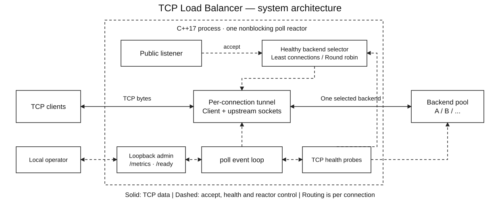
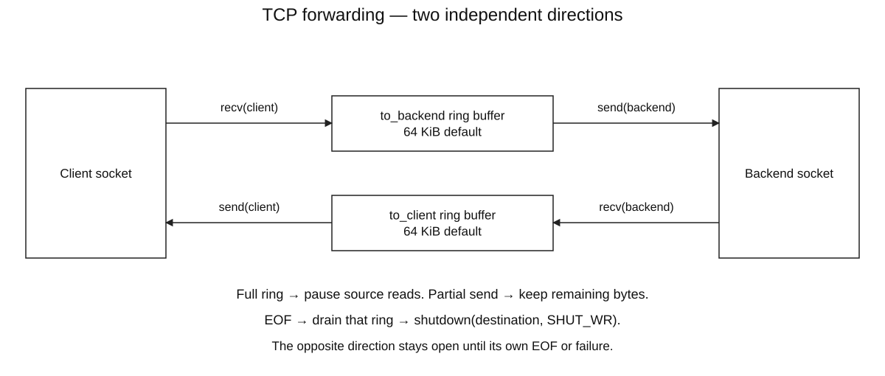
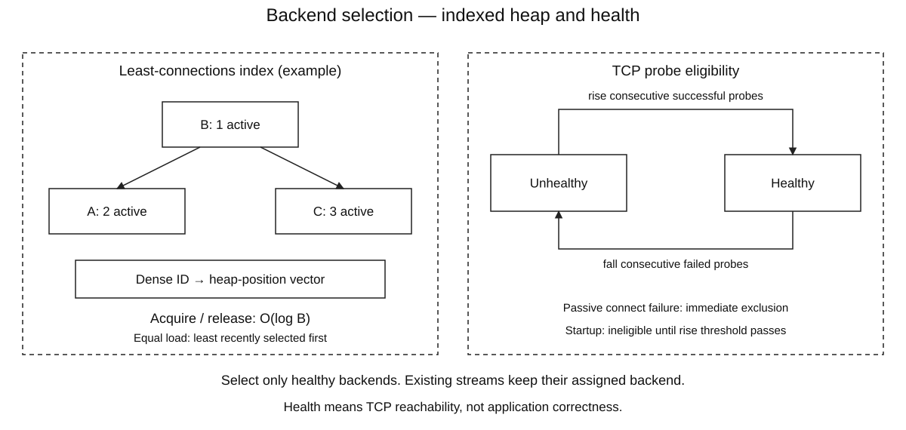

# TCP Load Balancer

A C++17 **Layer 4 TCP proxy** for macOS and Linux. It forwards real bidirectional byte streams to healthy backends using **least connections** or **round robin**, with bounded buffers, nonblocking connects, health checks and graceful draining.

**Ring buffers · indexed min-heap · poll-based reactor · partial I/O · TCP half-close · observable failure handling**

The implementation uses the C++ standard library and POSIX sockets. Python's standard library supplies test clients, demo servers and benchmark tooling. There is no GPU, external service or frontend framework requirement.

## Architecture



Each accepted connection is assigned to one backend. After the upstream connection succeeds, the stream remains attached to that backend. HTTP keep-alive requests on one TCP connection therefore stay on one backend; routing is **per connection**, not per HTTP request.

### Bidirectional data path



When a ring fills, its source socket is no longer polled for reads until space becomes available. Partial writes consume only the bytes actually sent. EOF closes one direction only after that direction's buffer drains. See [architecture](docs/ARCHITECTURE.md) for the state transitions and failure semantics.

### Backend selection and health



The reactor owns both traffic state and backend health. A backend must pass consecutive TCP probes before receiving new connections. Least-connections selects the minimum eligible heap entry; each acquired connection increments its load immediately, including while the upstream connect is pending. Completion or failure releases that lease. A health transition removes or reinserts an entry without losing counts for existing streams.

### A connection from accept to close

1. Accept a client and enforce the connection limit. Allocate two bounded rings for its pending bytes.
2. Select a healthy backend and begin a nonblocking connect. Record its ID in a 64-bit attempted mask.
3. If connect is pending, wait for readiness and inspect `SO_ERROR`. Client bytes may be buffered, but no application bytes are sent upstream before success.
4. A failed connect can release its lease and try another eligible, unattempted backend. Once a connect succeeds, that stream stays assigned to it; subsequent failures close the stream without replay.
5. Forward both directions independently. Reads stop when their destination ring fills; partial writes retain the unsent remainder.
6. On EOF, drain that direction before propagating `SHUT_WR`. Release the backend lease when the tunnel completes or fails.

All forwarding, probe completion, timers and admin sessions run in one `poll` reactor. Python is used only by the test, demo and benchmark tools. [Detailed design and invariants](docs/ARCHITECTURE.md) provide the source of truth for the diagrams; [image specifications](docs/DIAGRAMS.md) record how the illustrations were generated.

## Build

Requirements: C++17, `make`, POSIX sockets; Python 3.10+ for tests/demo/benchmark. Executed on macOS Apple Silicon; Linux/WSL instructions are provided but have not been executed on this development machine.

On macOS, install the compiler tools if needed:

```sh
xcode-select --install
```

Clone the repository and enter its directory:

```sh
git clone https://github.com/pigglegiggle/tcp-load-balancer.git
cd tcp-load-balancer
```

Then build and check it:

```sh
make
./build/tcp-lb --help
make test
```

There is no pip installation. `make` builds `build/tcp-lb`; an up-to-date build may say `Nothing to be done`.

On Ubuntu/Linux:

```sh
sudo apt update
sudo apt install build-essential clang python3
git clone https://github.com/pigglegiggle/tcp-load-balancer.git
cd tcp-load-balancer
make
make test
```

On Windows, install WSL2 from an administrator PowerShell terminal:

```powershell
wsl --install -d Ubuntu
```

Restart if prompted, finish Ubuntu setup, then use the Linux commands above **inside Ubuntu**. Keep the checkout on the Linux filesystem, such as `~/tcp-load-balancer`. Native Windows/MSVC builds are not configured. Linux/WSL builds have not been validated on this development Mac.

## Try it with real HTTP

Run the automated demonstration:

```sh
make demo
```

It starts two local HTTP backends and the compiled proxy, sends requests, stops backend A, verifies requests go to B, restarts A, verifies recovery, then cleans up the owned services. Successful output includes:

```text
Before failure: ['A', 'B', 'A', 'B', 'A', 'B']
A is down:      ['B', 'B', 'B', 'B']
A recovered:    ['A', 'B', 'A', 'B', 'A', 'B']
```

The recovered sequence may start with B depending on the round-robin cursor. Both live backends must appear. This demonstration forwards actual HTTP through opaque TCP streams; the proxy does not parse those HTTP requests.

For a browser/curl demo that stays running:

```sh
python3 scripts/demo.py --serve
```

- HTTP through proxy: <http://127.0.0.1:8600/hello>
- Proxy metrics: <http://127.0.0.1:8601/metrics>
- Readiness: <http://127.0.0.1:8601/ready>

Refresh `/hello` to see the backend identity. Demo responses close their connection so each refresh makes a new routing decision. Ctrl+C stops the proxy and the owned HTTP servers. Ports 8600/8601 must be free. The demo's two Python HTTP servers share one process; the proxy is a separate compiled C++ process, all communicating over real loopback TCP.

## Use your own backends

Start services on 9001 and 9002, then:

```sh
./build/tcp-lb \
  --listen 127.0.0.1:8080 \
  --admin 127.0.0.1:9091 \
  --backend 127.0.0.1:9001 \
  --backend 127.0.0.1:9002 \
  --policy least-connections
```

Backends are configured as unique **numeric IPv4:port** endpoints. Hostname resolution and IPv6 are not implemented. Backends start ineligible until TCP probes meet the rise threshold. Check readiness before sending application traffic:

```sh
curl -i http://127.0.0.1:9091/ready
curl -s http://127.0.0.1:9091/metrics | python3 -m json.tool
```

`--listen 0.0.0.0:8080` accepts traffic from other machines when local network/firewall configuration allows it. The admin listener is restricted to IPv4 loopback. TLS bytes can pass through as opaque data, but there is no TLS termination, certificate management, authentication or application-layer routing.

See [How to run](docs/HOW_TO_RUN.md) for complete options, troubleshooting and deployment boundaries.

## Routing and DSA

| Component | Structure | Behavior / cost |
|---|---|---|
| Pending bytes | Two fixed-capacity ring buffers per tunnel | O(1) metadata updates; no shifting pending bytes |
| Least-connections pool | Binary min-heap + dense ID-to-position vector | Minimum O(1); acquire/release/health change O(log B) |
| Fair ties | `(active count, last selection sequence, backend ID)` | Older selections win equal-load ties |
| Round robin | Cursor over configured IDs | Scans at most B backends, skipping ineligible/excluded entries |
| Retry exclusion | 64-bit attempted-backend mask | Each backend tried at most once per accepted connection |
| Active tunnels/admin sessions | ID-keyed unordered maps | Expected O(1) lookup; IDs protect against stale fd reuse |
| I/O readiness | `poll` descriptor/watch vectors | O(N+B+A) scanning; a portable baseline, not an epoll/kqueue claim |

B is at most 64 backends. Active load counts **connecting and established** client tunnels, excluding health probes. Failed/unhealthy backends are removed from the selection heap while existing tunnel leases retain their counts. Recovery reinserts them with the correct current load. The heap is maintained for both policies; round-robin acquisition/release also incurs its bookkeeping costs. Retry exclusions can require temporarily removing/restoring heap roots, up to O(B log B).

The configuration fixes backend IDs, so a dense position vector provides deterministic O(1) index lookup without hashing. Seeded tests compare selection against an independent linear reference and check heap/position invariants after every mutation.

## Reliability rules

- TCP connect completion is checked with `SO_ERROR`, not just socket writability.
- Connect failures before success can try another eligible backend. Application bytes are buffered until connection success, and **never replayed after success**, even if the backend later resets. Existing sessions are not migrated by health checks.
- Active probes use rise/fall hysteresis. A passive client-connect failure excludes its target immediately. A successful TCP probe establishes reachability, not service correctness.
- A client `SHUT_WR` still permits a backend response. The reverse direction also works: a backend can finish writing while continuing to read client data.
- Idle timeout measures time since the last successful byte transfer. Connect, probe, admin-request and drain lifetimes are bounded. Timer checks use a monotonic clock; poll sleeps until the nearest tracked deadline, capped at 250 ms plus event-loop work. The cap bounds the signal-check/poll race without fixed 20 ms idle wakeups.
- SIGINT/SIGTERM closes the public listener and drains current tunnels. The configured drain deadline closes remaining tunnels; a stuck client cannot keep shutdown alive indefinitely.
- Rapid client resets or socket-setup failures close that connection rather than terminate the reactor. Descriptor exhaustion pauses accept attempts; probe/socket setup failures are counted without automatically blaming an otherwise healthy backend.
- Socket descriptors are RAII-owned and close-on-exec. Pending bytes have explicit owners and the signal handler only sets a `sig_atomic_t` flag. SIGPIPE is ignored by the executable; send failures are handled as connection errors.

## Resource bounds

Defaults: **512 active tunnels**, **64 KiB per direction**, two rings per tunnel. That permits up to **64 MiB reserved ring capacity**, plus C++ metadata, admin state and kernel socket buffers. Occupied-buffer metrics are not process RSS. The configuration rejects more than 1 GiB of potential ring capacity.

The public accept loop handles at most 64 accepts per pass, and each readable/writable socket transfers at most 256 KiB per dispatch. Admin sessions are limited to 32, request headers to 8 KiB and lifetime to one second. These are bounded-resource choices, not a denial-of-service protection claim.

For large connection limits, inspect `ulimit -n`: the process needs roughly two descriptors per active tunnel, one per in-flight probe, up to 32 admin sessions, listeners and stdio. The configured active-connection limit does not raise OS descriptor limits.

## Tests and measurements

Validated on the development Mac: **2,190,310 unit checks and 161 integration checks**, with the same suites passing AddressSanitizer and UndefinedBehaviorSanitizer builds. Unit checks include seeded differential tests of ring operations against a deque and backend selection against an independent linear reference.

A measured loopback run with 32 persistent clients produced a **3.197 ms proxy p95** versus **3.082 ms direct p95** for 256-byte verified echoes. The 16-client bulk run measured **903.74 MiB/s through the proxy** versus **912.32 MiB/s direct**, counting payload once despite the echo round trip. These are end-to-end measurements with Python clients/backends on the same Mac, not production capacity or isolated proxy CPU measurements. Full configuration, raw samples and source/binary hashes are linked below.

```sh
make test
make sanitize
make benchmark
```

The test suite covers binary/fragmented/full-duplex traffic, both half-close directions, concurrent client isolation, routing distribution, backend failure/recovery, safe pre-connect retries, no replay after delivery, buffer pressure, rapid resets, connection/idle limits, admin validation and graceful/forced draining. Sanitizer runs exercise the same real socket integration tests.

`make benchmark` compares direct TCP with the proxy path using the same two echo backends. It checks every response and records request latency and bulk payload throughput at several concurrency levels. It reports the proxy's overhead, not a claim to make direct TCP faster. See the [measured report](docs/PERFORMANCE_REPORT.md), [methodology](docs/BENCHMARKS.md), [test coverage](docs/TESTING.md) and [raw samples](docs/benchmarks/latest.json).

## Code style

Small concrete types, explicit ownership, names that describe the job, and comments that explain edge cases. The event loop owns mutable routing/connection state; there are no worker-thread locks or a custom async framework. `.clang-format` records the formatting rules. Correctness comes before cleverness, and every performance claim needs a measurement.

## Repository map

```text
include/lb/buffer.hpp    Fixed-capacity ring buffer
include/lb/backends.hpp  Indexed selection heap, routing policies and lease accounting
include/lb/server.hpp    Configuration and public entry point
src/server.cpp          Sockets, event loop, probes, tunnels, admin and metrics
src/main.cpp            CLI and signal setup
tests/unit.cpp          Differential DSA and config checks
tests/integration.py    Real socket/process failure-path tests
tests/support.py        Shared stdlib-only fixtures
scripts/demo.py         Real HTTP demo and failure/recovery walkthrough
scripts/benchmark.py    Verified loopback measurements and report
docs/                   Run guide, design, testing and measurements
```
